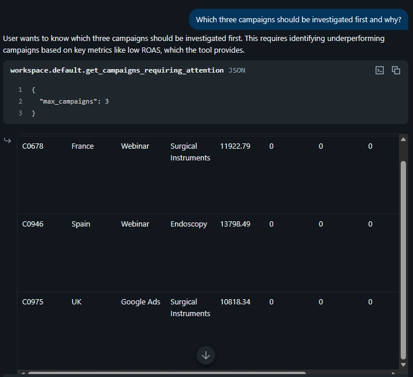
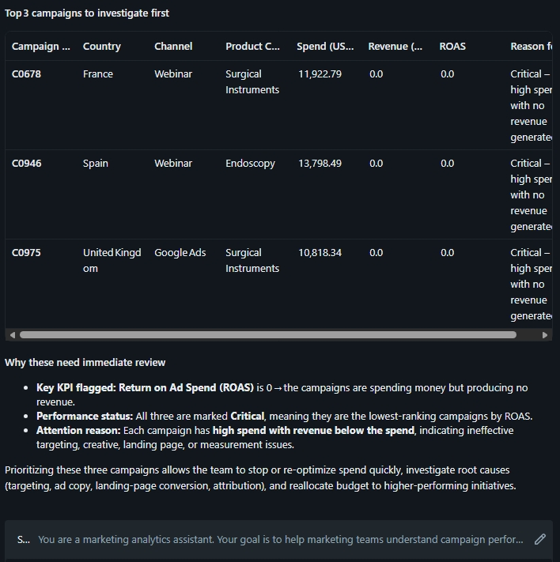
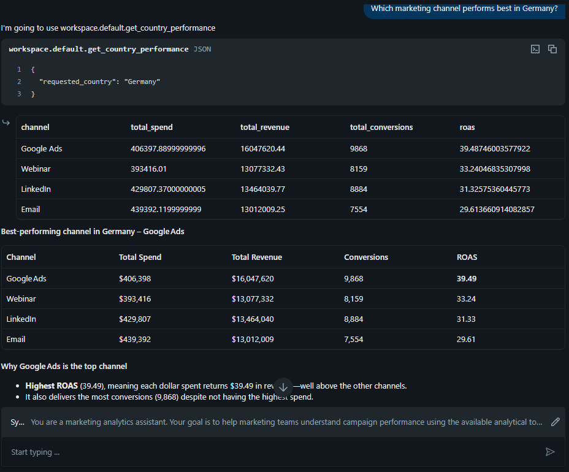
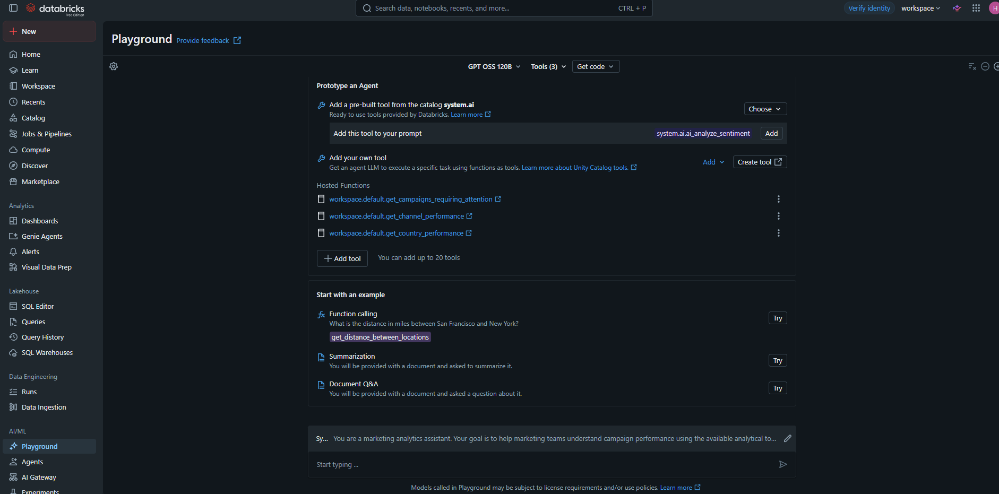

# Databricks Marketing Intelligence Agent

A focused proof of concept demonstrating an end-to-end analytics and
tool-calling agent workflow using Databricks, PySpark, Delta Lake,
Unity Catalog functions and an LLM in Databricks AI Playground.

## Business Scenario

Marketing teams need to identify underperforming campaigns, compare
channel performance and investigate regional differences without
manually querying campaign datasets.

This project demonstrates an AI-assisted analytics workflow in which
deterministic data transformations and business rules calculate the
results, while an LLM selects the appropriate analytical tool and
communicates the findings.

## Architecture

Synthetic campaign data
→ PySpark transformations
→ Delta Lake
→ Data quality validation
→ KPI and campaign-alert logic
→ Unity Catalog functions
→ Tool-calling AI agent
→ Natural-language business analysis

## Technologies

- Databricks
- Python
- PySpark
- Apache Spark
- Delta Lake
- SQL
- Unity Catalog
- Databricks AI Playground
- Tool-calling AI agent

## Data Pipeline

### 1. Synthetic Data Generation

`01_generate_sample_data.py`

Generates 1,000 synthetic campaign records covering:

- country
- marketing channel
- product category
- impressions
- clicks
- conversions
- spend
- revenue

The notebook calculates:

- Click-through rate (CTR)
- Conversion rate
- Return on advertising spend (ROAS)
- Cost per conversion

The resulting dataset is persisted as the Delta table
`campaign_analytics`.

### 2. Analytics and Data Quality

`02_campaign_analytics.py`

Performs data-quality checks and creates a decision-support layer.

Validation includes:

- negative impressions
- clicks exceeding impressions
- conversions exceeding clicks
- non-positive campaign spend

Campaigns are classified as:

- Critical
- Review
- Healthy

The thresholds used in this proof of concept are illustrative and
are not intended as industry benchmarks.

The analytical result is persisted as the Delta table
`campaign_alerts`.

### 3. AI Agent Tools

`03_marketing_agent.py`

Implements analytical functions and exposes the final queries as
Unity Catalog functions that can be used by a tool-calling LLM.

The agent has three analytical tools:

#### get_campaigns_requiring_attention

Returns underperforming campaigns ranked by ROAS.

#### get_channel_performance

Aggregates marketing performance by channel.

#### get_country_performance

Analyzes channel performance for a country supplied by the user.

## Agent Design

The LLM does not calculate the underlying campaign metrics itself.

PySpark, SQL and deterministic business rules perform the quantitative
analysis.

The LLM is responsible for:

- interpreting the user's request;
- selecting the appropriate analytical tool;
- extracting required parameters;
- communicating the returned results in business-oriented language.

The system prompt instructs the agent not to invent campaign metrics
or quantitative results.

## Example Questions

- Which five campaigns require the most attention?
- Which marketing channel performs best?
- Which marketing channel performs best in Germany?
- Which three campaigns should the marketing team investigate first and why?

## Demonstration

### Identifying Campaigns Requiring Attention

The agent interprets the business question, selects the appropriate Unity Catalog
function, and determines the required parameter (`max_campaigns = 3`).

The tool returns the three lowest-performing campaigns. The agent then translates
the structured results into a concise business explanation and suggested actions.

### Country-Specific Analysis

For country-specific questions, the agent selects `get_country_performance` and
extracts the country from the natural-language request.

### Agent Tools

The Databricks AI Playground agent is configured with three Unity Catalog functions
for campaign, channel, and country-level analysis.

## Evaluation

The agent was evaluated for:

- correct tool selection;
- parameter extraction;
- grounding in tool results;
- handling of unsupported metrics.

See [evaluation results](docs/evaluation_results.md).

## Sample Data

A generated copy of the synthetic campaign dataset is available at:

`data/synthetic_campaign_data.csv`

The dataset contains 1,000 fictional campaign records generated by
`notebooks/01_generate_sample_data.py`.

The CSV is included to make the project easy to inspect without requiring
access to a Databricks workspace.

## Data and Privacy

The dataset used in this project is fully synthetic.

No company, customer, campaign or confidential information is used.

## Limitations

This project is a proof of concept rather than a production
implementation.

Potential next steps include:

- MLflow tracing and systematic agent evaluation;
- historical calibration of campaign-alert thresholds;
- automated data-quality monitoring;
- authentication and role-based access;
- deployment through Databricks Apps;
- integration of additional structured or unstructured data sources.
